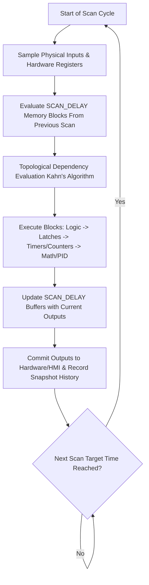

# AutomationHub // Comprehensive Project Handover Documentation

> **Version:** 2.4.0 (Production Master)  
> **Repository:** `https://github.com/Aureum21/industrial_automation.git`  
> **Production URL:** `https://www.industrialautomation.website/`  
> **Lead Author & Platform Architect:** Alazar Wake Kore ([Portfolio](https://www.alazarwakekore.online/))  
> **Last Updated:** November 2026  
> **Verification Status:** 83/83 Unit Tests Passing · Zero TypeScript Errors · Production Build Verified  

---

## Table of Contents

1. [Executive Summary & Platform Mission](#1-executive-summary--platform-mission)
2. [Technology Stack & Core Dependencies](#2-technology-stack--core-dependencies)
3. [Architecture & Directory Structure](#3-architecture--directory-structure)
4. [Deterministic PLC Logic Simulator (`LogicEngine.ts`)](#4-deterministic-plc-logic-simulator-logicenginets)
5. [The 74-Block Component Catalog (`catalog.ts`)](#5-the-74-block-component-catalog-catalogts)
6. [Standalone Arduino C++ Code Generator (`arduinoGenerator.ts`)](#6-standalone-arduino-c-code-generator-arduinogeneratorts)
7. [The 11 Industrial Masterclasses Catalog](#7-the-11-industrial-masterclasses-catalog)
8. [Multi-Author Studio & Security Isolation System](#8-multi-author-studio--security-isolation-system)
9. [Database Architecture & Persistence (Neon PostgreSQL)](#9-database-architecture--persistence-neon-postgresql)
10. [SCADA HMI Dashboard & Oscilloscope Logic Analyzer](#10-scada-hmi-dashboard--oscilloscope-logic-analyzer)
11. [Design System & UI Theme (Apple Charcoal Steel)](#11-design-system--ui-theme-apple-charcoal-steel)
12. [Testing & Quality Assurance Guide](#12-testing--quality-assurance-guide)
13. [Operations Runbook & Deployment Workflow](#13-operations-runbook--deployment-workflow)
14. [Future Engineering Roadmap](#14-future-engineering-roadmap)

---

## 1. Executive Summary & Platform Mission

**AutomationHub** is an open-access, browser-native industrial control systems education, simulation, and hardware compilation platform. Built to eliminate the prohibitive cost barrier of physical PLCs and proprietary industrial software (Siemens TIA Portal, Rockwell Studio 5000), AutomationHub allows engineers, students, and technicians to:

* **Design and Simulate Deterministic PLC Logic:** Wire visual Function Block Diagrams (FBD) executing on real-time scan cycles with millisecond precision.
* **Master Real-World Control Engineering:** Engage with 11 comprehensive masterclasses covering forensic case studies (catastrophic industrial disasters), first-principles physics, and multi-stage interactive FBD circuits.
* **Bridge Software to Physical Hardware (Export to Arduino):** Convert visual circuits into standalone, library-free C++ (`.ino`) sketches that run on microcontrollers (Arduino Uno/Nano/Mega, ESP32, Raspberry Pi Pico) with non-blocking deterministic scan cycles.
* **Author & Publish Technical Content:** Multi-author publishing studio with user isolation, visual lab embedding, and cloud persistence.

---

## 2. Technology Stack & Core Dependencies

| Layer | Technology | Version | Purpose / Architecture Rationale |
| :--- | :--- | :--- | :--- |
| **Framework** | Next.js (App Router) | 16.3.7 | Fast static site generation (SSG) + dynamic serverless API routes with Turbopack |
| **Runtime** | React / React DOM | 19.x | Concurrent rendering, server actions, and modern hook architecture |
| **Language** | TypeScript | 5.x | Strict type safety across logic engines, DSL compilers, and schemas |
| **Visual Canvas** | `@xyflow/react` (React Flow) | 12.x | Hardware-accelerated infinite canvas for Function Block Diagrams (FBD) |
| **Styling** | Tailwind CSS | 4.x | Utility-first CSS configured with custom Apple Charcoal Steel color system |
| **Database** | Neon Serverless PostgreSQL | `@neondatabase/serverless` | Distributed SQL storage for users, masterclasses, and live view metrics |
| **Authentication** | Web Crypto API | Native | PBKDF2 password hashing, salt derivation, and HTTP-only session cookies |
| **Test Runner** | Node.js Test Runner | Native (`node:test`) | Ultra-fast native execution using `--experimental-strip-types` (no Babel/Jest overhead) |
| **Icons** | `lucide-react` | 1.x | Clean, industrial iconography |

---

## 3. Architecture & Directory Structure

```
automation-hub/
├── public/                       # Static brand assets (icons, favicons, SVGs)
├── src/
│   ├── app/                      # Next.js App Router endpoints & page views
│   │   ├── api/                  # Serverless API routes
│   │   │   ├── articles/         # Masterclasses CRUD & publishing endpoints
│   │   │   ├── auth/             # Sign-in, sign-up, sign-out, password updates
│   │   │   ├── health/           # Database connection health check
│   │   │   └── views/            # Live telemetry page read counters
│   │   ├── blogs/                # Masterclass index & directory
│   │   ├── lab/                  # Standalone full-screen visual logic lab
│   │   ├── library/              # 74-block industrial component catalog reference
│   │   ├── post/[slug]/          # Masterclass viewer (PostClientView.tsx)
│   │   ├── signin/ & signup/     # Authentication station
│   │   ├── write/                # Multi-author studio & lab adder
│   │   ├── layout.tsx            # Root HTML layout & global SiteHeader
│   │   ├── page.tsx              # Homepage (hero sim, pillars, author spotlight)
│   │   └── globals.css           # Global Tailwind & charcoal palette definitions
│   ├── components/
│   │   ├── lab/                  # Logic Lab core components
│   │   │   ├── oscilloscope/     # 8-channel logic analyzer & time-scrubber
│   │   │   ├── ArduinoExportModal.tsx # Microcontroller pin configurator & .ino exporter
│   │   │   ├── CircuitNode.tsx   # Custom FBD node with pin handles & status LEDs
│   │   │   ├── HmiCanvas.tsx     # SCADA dashboard drag-and-drop builder
│   │   │   ├── InlineLab.tsx     # Embedded interactive simulation card for articles
│   │   │   └── LabWorkspace.tsx  # Primary React Flow canvas & toolbar
│   │   ├── Sidebar.tsx           # Component drawer for canvas
│   │   └── SiteHeader.tsx        # Global navigation with active pills & portfolio link
│   └── lib/
│       ├── automation/           # Industrial automation domain logic
│       │   ├── catalog.ts        # Specifications for all 74 blocks
│       │   ├── documents.ts      # CircuitDocument validator, parser, & serializer
│       │   ├── dsl.ts            # Text-based circuit DSL parser & stringifier
│       │   ├── examples.ts       # Starter circuit factory templates
│       │   ├── layout.ts         # Dagre auto-layout positioning algorithm
│       │   └── types.ts          # Core TypeScript contracts & types
│       ├── codegen/              # Code generation engines
│       │   └── arduinoGenerator.ts # Standalone C++ Arduino sketch compiler
│       ├── auth.ts               # Client session state & storage listeners
│       ├── authCrypto.ts         # PBKDF2 password derivation & crypto verification
│       ├── blogPermissions.ts   # Core masterclass protection & author isolation rules
│       ├── blogStorage.tsx       # Cloud sync, local storage fallback, & post transformers
│       ├── db.ts                 # Neon PostgreSQL schema setup & SQL clients
│       ├── defaultArticlesData.ts# Serialized JSON masterclasses for database seeding
│       ├── mockPosts.tsx         # Static masterclass articles with embedded JSX & labs
│       └── LogicEngine.ts        # Deterministic PLC simulation engine
└── tests/                        # Automated unit & regression test suite (83 tests)
    ├── arduino_codegen.test.ts   # Arduino generator, presets, and non-blocking timing
    ├── author_isolation.test.ts  # Multi-author security & core masterclass protection
    ├── boiler_dsl.test.ts        # Masterclass 11 3-stage DSL execution
    ├── documents.test.ts         # Circuit document validation, limits, & serialization
    ├── dsl.test.ts               # DSL grammar, syntax errors, & round-tripping
    ├── engine.test.ts            # LogicEngine cycle determinism & block evaluations
    └── scenarios.test.ts         # Time-domain assertions & multi-scan simulations
```

---

## 4. Deterministic PLC Logic Simulator (`LogicEngine.ts`)

The simulation engine is modeled directly after physical Programmable Logic Controllers (PLCs), running a cyclic scan execution loop rather than event-driven dispatch:



### Key Technical Characteristics:
1. **Dependency Graph & Topological Sort:**
   Blocks are evaluated strictly according to signal dependency order using Kahn's topological sort algorithm. Upstream blocks always evaluate before downstream receivers, eliminating race conditions and execution order anomalies.
2. **Deterministic Feedback Loop Resolution (`SCAN_DELAY`):**
   In real industrial PLCs, feedback loops cannot resolve within a single scan. The engine enforces this requirement: closed loops must pass through a `SCAN_DELAY` (or `ANALOG_SCAN_DELAY`) block, whose output is explicitly latched to the previous scan's sampled value. Any unbuffered combinational feedback is rejected with an informative error.
3. **Time-Travel Snapshot Ring Buffer:**
   Every scan cycle records an immutable snapshot of all block input/output signals in an internal ring buffer (storing up to 3,000 scans, or 5 minutes at 100ms intervals). This powers the interactive Oscilloscope / Logic Analyzer.

---

## 5. The 74-Block Component Catalog (`catalog.ts`)

The catalog spans 10 distinct categories, providing complete parity with industrial function block programming:

| Category | Available Blocks | Industrial Functionality |
| :--- | :--- | :--- |
| **Digital I/O** | `INPUT`, `NC_INPUT`, `OUTPUT`, `HIGH`, `LOW`, `FLAG`, `OPEN_CONNECTOR` | Field pushbuttons, contactors, normally-closed limit switches, internal flags |
| **Analog I/O** | `ANALOG_INPUT`, `ANALOG_OUTPUT`, `ANALOG_FLAG`, `ANALOG_CONSTANT` | 4–20mA / 0–10V transmitters, proportional valves, setpoints |
| **Combinational Logic** | `AND`, `OR`, `NOT`, `XOR`, `NAND`, `NOR`, `XNOR`, `AND_EDGE`, `NAND_EDGE` | Safety interlocks, permissive chains, conditional gating |
| **Latches & Flips** | `RS_LATCH`, `PULSE_RELAY` | Reset-dominant motor start/stop seals, impulse toggle relays |
| **Edge Detectors** | `R_TRIG`, `F_TRIG` | One-shot scan pulses on rising or falling transitions |
| **Timers** | `TON`, `TOF`, `ON_OFF_DELAY`, `RETENTIVE_TON`, `PULSE_TIMER` (TP), `EDGE_PULSE_TIMER`, `CLOCK` | On-delay, off-delay, anti-short cycle, retentive run timers, periodic clocks |
| **Counters** | `COUNTER`, `HOURS_COUNTER`, `FREQUENCY_TRIGGER` | Up/down item counting with preset limit, equipment running hours |
| **Analog Processing** | `MATH`, `ANALOG_COMPARATOR`, `ANALOG_THRESHOLD`, `ANALOG_AMPLIFIER`, `ANALOG_MUX`, `ANALOG_DIFFERENTIAL`, `ANALOG_RAMP`, `ANALOG_FILTER`, `MIN_MAX`, `AVERAGE` | Algebraic calculations (`+`, `-`, `*`, `/`), Schmitt trigger hysteresis, slew rate limiters, first-order EMA filters |
| **Control & Dynamics** | `PI_CONTROLLER`, `PID_CONTROLLER`, `PWM`, `TRANSFER_FUNCTION`, `SIGNAL_GENERATOR`, `MATH_EXPRESSION` | Closed-loop PID with anti-windup, solid-state relay PWM, first-order plant lag ($1/(Ts+1)$) |
| **Data & Module** | `FLOAT_TO_INT`, `INT_TO_FLOAT`, `SCAN_DELAY`, `ANALOG_SCAN_DELAY`, `DATA_LOG`, `UDF` | Explicit scan memory boundaries, periodic CSV data logging, user-defined functions |

---

## 6. Standalone Arduino C++ Code Generator (`arduinoGenerator.ts`)

A signature capability of AutomationHub is compiling visual FBD circuits directly into standalone, runnable Arduino `.ino` sketches.

### Design Principles:
1. **Zero External Libraries:** Compiles immediately on any stock Arduino IDE installation without requiring third-party library manager downloads.
2. **Strictly Non-Blocking Execution (No `delay()`):** All timers, latches, and PID loops execute via non-blocking `millis()` delta-timing rings:
   ```cpp
   unsigned long now = millis();
   unsigned long dt = now - lastScan;
   if (dt < SCAN_CYCLE_MS) return; // Yield CPU to maintain deterministic scan frequency
   lastScan = now;
   ```
3. **Embedded Industrial Structs:** Clean, optimized C++ structs embedded directly at the top of the sketch:
   * `TON_Timer`, `TOF_Timer`, `TP_Timer`, `ON_OFF_Delay`, `RetentiveTON`
   * `RS_Latch`, `PulseRelay`, `R_Trig`, `F_Trig`, `UpDownCounter`
   * `ClockGen`, `HysteresisTrigger`, `AnalogRamp`, `PIController`, `AnalogFilter`
4. **Target Board Presets:**
   * **Arduino Uno / Nano (ATmega328P):** 10-bit ADC (0–1023), 5V logic.
   * **Arduino Mega 2560:** 54 digital I/O pins, 16 analog ADC pins.
   * **ESP32 (NodeMCU / DevKit):** 12-bit ADC (0–4095), 3.3V logic, high-speed 240MHz execution.
   * **Raspberry Pi Pico (RP2040):** 12-bit ADC (0–4095), 3.3V logic.
5. **Breadboard-Friendly Pin Defaults:**
   * Digital inputs default to `INPUT_PULLUP` with inverted logic. A momentary button wired directly between the microcontroller pin and `GND` reads `HIGH` when pressed, requiring no external pull-down resistors.
   * Analog inputs configure hardware ADC channels with engineering unit scaling.
   * Analog outputs map to hardware PWM pins (`3`, `5`, `6`, `9`, `10`, `11`).
6. **Serial Telemetry Stream:**
   * `#define ENABLE_SERIAL_TELEMETRY 1` at 115200 baud prints real-time scan cycle state tables directly to the Arduino Serial Monitor.

---

## 7. The 11 Industrial Masterclasses Catalog

Each masterclass pairs forensic engineering disaster analysis with first-principles control physics, ISA-5.1 P&ID blueprints, and 3 progressive, interactive FBD simulation stages:

| # | Slug | Masterclass Title | Forensic Case Study & Key Control Theory |
| :---: | :--- | :--- | :--- |
| **01** | `water-treatment` | **Municipal Water Reclamation & Basin Level Control** | Cavitation seal blowout; Intake permissives, basin hysteresis, and duty alternation. |
| **02** | `hydraulic-press-safety-interlock` | **Hydraulic Stamping Safety & Anti-Tie-Down Systems** | Crushing limb injury; Category 4 / PLe anti-tie-down concurrent edge detection ($<500\text{ms}$), optical light curtain muting. |
| **03** | `dual-pump-alternator` | **Duplex Lift Station Pump Alternation & Failover** | Wet well overflow; Running hours equalization, automatic thermal overload failover, multi-float hysteresis. |
| **04** | `industrial-heater-pi-pwm-anti-windup` | **Process Thermal Control & Time-Proportioned PWM** | Polymer thermal degradation; Closed-loop PI with anti-windup clamping, zero-crossing solid-state relay PWM. |
| **05** | `solar-tracker-mppt-hysteresis` | **Dual-Axis Solar Photovoltaic Tracking & Storm Stow** | High-wind gear drive destruction; Dual-axis photodiode differential tracking with hysteresis deadbands and anemometer storm stow. |
| **06** | `hvac-chiller-economizer` | **Commercial HVAC Enthalpy Economizer & Chiller Sequencing** | Simultaneous heating/cooling energy waste; Psychrometric enthalpy differential comparator, anti-short cycle compressor delay. |
| **07** | `conveyor-bottle-sorter` | **High-Speed Inspection & Shift Register Pneumatic Rejection** | Broken glass packaging jam; Bit-shifting FIFO register tracking, optical sensor debouncing, solenoid reject pulse timing. |
| **08** | `traffic-intersection-controller` | **Multi-Phase Traffic Controller & Emergency Preemption** | High-speed intersection collision; Four-state traffic sequencer, minimum yellow clearance timing, optical emergency preemption. |
| **09** | `emergency-shutdown-esd-matrix` | **Refinery Emergency Shutdown (ESD) Matrix & 2oo3 Voting** | Hydrocarbon vapor cloud explosion; Two-out-of-three (2oo3) sensor voting logic, de-energize-to-trip failsafe, manual key reset. |
| **10** | `tank-level-cascade-pid` | **Cascade Level-to-Flow Control & Anti-Cavitation Loops** | Centrifugal pump impeller pitting; Primary Level PID modulating Secondary Inflow PI loop, low-level cavitation trip. |
| **11** | `steam-boiler-drum-level` | **3-Element Steam Boiler Drum Level & NFPA 85 Safeguards** | Unit 4 superheater tube meltdown; Shrink & swell bubble expansion physics, feedforward mass balance, NFPA 85 LLWL burner trip. |

---

## 8. Multi-Author Studio & Security Isolation System

AutomationHub features a complete multi-author publishing platform (`/write`) designed to encourage community contributions while strictly safeguarding core intellectual property.

### Security & Permission Rules ([`src/lib/blogPermissions.ts`](file:///c:/Users/wakek/Desktop/engineering/automation-hub/src/lib/blogPermissions.ts)):
1. **Core Masterclass Protection (`CORE_MASTERCLASS_SLUGS`):**
   * The 11 core masterclasses are permanently locked and can **only** be modified or updated by Lead Author **Alazar Wake Kore** (`isAuthorUser`).
   * For all other logged-in users, core masterclass editors are read-only, preventing unauthorized edits, overrides, or deletions.
2. **Community Author Workspace Isolation:**
   * When community engineers sign in (e.g. `marcus_chen`, `elena_r`), their `/write` Studio displays exclusively their own articles.
   * `getUserStorageKey(user)` isolates local drafts per user account in browser storage (`fieldnotes.articles.usr-xxx`), ensuring drafts never bleed across user sessions.
3. **Multi-Option Interactive Lab Adder:**
   Authors can embed interactive simulation exercises into any article using 5 integrated methods:
   * **Import from Visual Lab:** Grab the currently wired circuit active in `/lab`.
   * **Industrial Presets:** 1-click insertion of verified circuits (Start/Stop Latch, Two-Input Safety AND, Analog Scaling).
   * **Upload JSON:** Import an exported `.json` schematic file.
   * **In-Place Live Simulation:** Interactive test runner embedded directly inside the editor card.
   * **Syntax-Validated DSL Editor:** Live parsing of circuit code with real-time error feedback.

---

## 9. Database Architecture & Persistence (Neon PostgreSQL)

The platform connects to a **Neon Serverless PostgreSQL** database ([`src/lib/db.ts`](file:///c:/Users/wakek/Desktop/engineering/automation-hub/src/lib/db.ts)) with automatic fallback to isolated client storage if the database is unconfigured.

### Database Schema:

#### 1. `users` Table
```sql
CREATE TABLE IF NOT EXISTS users (
  id VARCHAR(64) PRIMARY KEY,
  name VARCHAR(120) NOT NULL,
  email VARCHAR(180) UNIQUE NOT NULL,
  password_hash VARCHAR(256) NOT NULL,
  role VARCHAR(32) NOT NULL DEFAULT 'author',
  avatar VARCHAR(16),
  created_at TIMESTAMP WITH TIME ZONE DEFAULT CURRENT_TIMESTAMP
);
```

#### 2. `articles` Table
```sql
CREATE TABLE IF NOT EXISTS articles (
  id VARCHAR(64) PRIMARY KEY,
  slug VARCHAR(140) UNIQUE NOT NULL,
  title VARCHAR(240) NOT NULL,
  excerpt TEXT,
  author VARCHAR(120) NOT NULL,
  author_url VARCHAR(255),
  author_id VARCHAR(64) REFERENCES users(id),
  author_email VARCHAR(180),
  date VARCHAR(32),
  reading_time VARCHAR(48),
  tag VARCHAR(64),
  views INTEGER DEFAULT 1,
  content_json TEXT NOT NULL,
  created_at TIMESTAMP WITH TIME ZONE DEFAULT CURRENT_TIMESTAMP,
  updated_at TIMESTAMP WITH TIME ZONE DEFAULT CURRENT_TIMESTAMP
);
```

#### 3. `views` Table
```sql
CREATE TABLE IF NOT EXISTS views (
  slug VARCHAR(140) PRIMARY KEY,
  view_count INTEGER DEFAULT 0,
  updated_at TIMESTAMP WITH TIME ZONE DEFAULT CURRENT_TIMESTAMP
);
```

---

## 10. SCADA HMI Dashboard & Oscilloscope Logic Analyzer

### 1. SCADA HMI Canvas ([`src/components/lab/HmiCanvas.tsx`](file:///c:/Users/wakek/Desktop/engineering/automation-hub/src/components/lab/HmiCanvas.tsx))
Allows users to switch from the technical FBD wire view to an operator control room screen:
* **Widgets:** Toggle switches, momentary pushbuttons, indicator pilot lights, analog dial gauges, vertical tank level bars, and slider controls.
* **Tag Binding:** Widgets bind wirelessly to circuit blocks via shared tags (e.g., tag `Motor_Run` binds an FBD `OUTPUT` to a green pilot lamp widget).

### 2. Time-Travel Oscilloscope ([`src/components/lab/oscilloscope/`](file:///c:/Users/wakek/Desktop/engineering/automation-hub/src/components/lab/oscilloscope/))
* **Multi-Channel Logic Analyzer:** Tracks up to 8 digital or analog signals simultaneously.
* **Interactive Time-Scrubbing:** Drag the timeline cursor backward to inspect previous states, verify pulse widths, and diagnose transient timing race conditions.

---

## 11. Design System & UI Theme (Apple Charcoal Steel)

The user interface follows an **Apple-inspired Charcoal Steel** design language combining high-contrast industrial legibility with minimalist elegance:

| Token | Hex Value | Application |
| :--- | :--- | :--- |
| **Canvas Background** | `#fbfbfd` | Main lab canvas background and body backdrop |
| **Card / Surface Background** | `#ffffff` / `#f5f5f7` | Content cards, component libraries, and sidebars |
| **Charcoal Steel (Dark Modals)**| `#1c1c1e` | Arduino Export Modal, dark code viewers, and tooltips |
| **Charcoal Surface Elevated** | `#2c2c2e` / `#3a3a3c` | Modal toolbars, tab pills, and table headers |
| **Primary Text** | `#1d1d1f` | Headings, primary labels, and high-contrast titles |
| **Secondary Text** | `#86868b` / `#8e8e93` | Metadata, unit annotations, and timestamps |
| **Engineering Accent Blue** | `#0071e3` / `#0077ed` | Action buttons, active navigation pills, primary links |
| **Operational Green** | `#059669` / `#30d158` | Verified status badges, live signal indicators, and safe states |
| **Safety Warning Amber** | `#d97706` / `#f59e0b` | Caution callouts, Arduino lightning accents (`⚡`), alerts |
| **Emergency Trip Red** | `#dc2626` / `#ef4444` | Hazard trips, LLWL alarms, and delete actions |

---

## 12. Testing & Quality Assurance Guide

AutomationHub maintains a strict, zero-regression test baseline executed via Node's native test runner (`node:test`):

```sh
# Run the complete test suite
node --experimental-strip-types --test tests/*.test.ts
```

### Test Suite Inventory (83 Tests):
1. **`tests/arduino_codegen.test.ts` (5 tests):**
   * Validates Uno, Nano, Mega, ESP32, and Pico board presets.
   * Verifies auto-pin allocation (`INPUT_PULLUP` inversion, PWM channels, ADC scaling).
   * Validates topological ordering of generated C++ code.
   * Asserts non-blocking `millis()` execution (zero `delay()` calls allowed).
   * Validates 12-bit ADC scaling (`4095.0f`) on ESP32/Pico sketches.
2. **`tests/author_isolation.test.ts` (5 tests):**
   * Validates lead author identification (`isAuthorUser`).
   * Asserts `CORE_MASTERCLASS_SLUGS` contains all 11 protected masterclasses.
   * Tests strict write-protection of core masterclasses against non-lead accounts.
   * Verifies community author workspace isolation and storage key separation.
3. **`tests/boiler_dsl.test.ts` (1 test):**
   * Parses and executes all 3 stages of Masterclass 11 in `LogicEngine`.
4. **`tests/documents.test.ts` (23 tests):**
   * Tests JSON document envelopes, graph limits, duplicate ID rejection, and signal validation.
5. **`tests/dsl.test.ts` (29 tests):**
   * Validates DSL grammar, lexer tokens, forward references, comments, and round-tripping.
6. **`tests/engine.test.ts` (15 tests):**
   * Tests execution determinism across all catalog blocks, feedback loops, latches, and math.
7. **`tests/scenarios.test.ts` (5 tests):**
   * Multi-scan temporal assertions and time-domain scenario verification.

---

## 13. Operations Runbook & Deployment Workflow

### Local Development Setup:
```sh
# 1. Clone repository
git clone https://github.com/Aureum21/industrial_automation.git
cd industrial_automation/automation-hub

# 2. Install dependencies
npm ci

# 3. Configure environment variables (optional for local simulation; required for cloud sync)
cp .env.example .env.local
# Set DATABASE_URL=postgresql://...

# 4. Start local development server (Turbopack)
npm run dev

# 5. Access local server
# Open http://localhost:3000 in your browser
```

### Pre-Deployment Verification Commands:
```sh
# Verify TypeScript compilation (0 errors required)
npm run typecheck

# Run complete automated test suite (83 passing tests required)
npm test

# Build production distribution
npm run build
```

### Deployment Pipeline:
* **Host:** Vercel
* **Trigger:** Git push to `main` branch on GitHub (`https://github.com/Aureum21/industrial_automation.git`).
* **Environment Variables in Vercel:**
  * `DATABASE_URL` / `POSTGRES_URL`: Connection string to Neon PostgreSQL.

---

## 14. Future Engineering Roadmap

1. **WebSerial Direct Microcontroller Flashing:**
   * Integrate the WebSerial API directly into `ArduinoExportModal.tsx` to compile and flash `.ino` sketches to connected USB boards directly from Google Chrome without needing the Arduino IDE desktop app.
2. **Ladder Logic (LD) Bi-Directional Transpiler:**
   * Provide a dual-view compiler allowing users to toggle between Function Block Diagrams (FBD) and traditional European/American Ladder Logic (rungs, NO/NC contacts, coils).
3. **Expanded Masterclasses (Future Candidates):**
   * *Masterclass 12:* Centrifugal Compressor Dynamic Anti-Surge Control & SCL Deviation Tracking.
   * *Masterclass 13:* Exothermic Chemical Batch Reactor Split-Range Thermal Control (ISA S88/S95).
   * *Masterclass 14:* Mining Overland Conveyor Dual-VFD Master-Slave Torque Load Sharing.
4. **OPC-UA / Modbus TCP Web Bridge:**
   * Enable real-time software-in-the-loop (SIL) testing by connecting the browser `LogicEngine` to local Factory I/O or CODESYS virtual PLC instances over WebSockets.

---

*Handover documentation prepared and certified by Antigravity for Alazar Wake Kore and the AutomationHub engineering team.*
